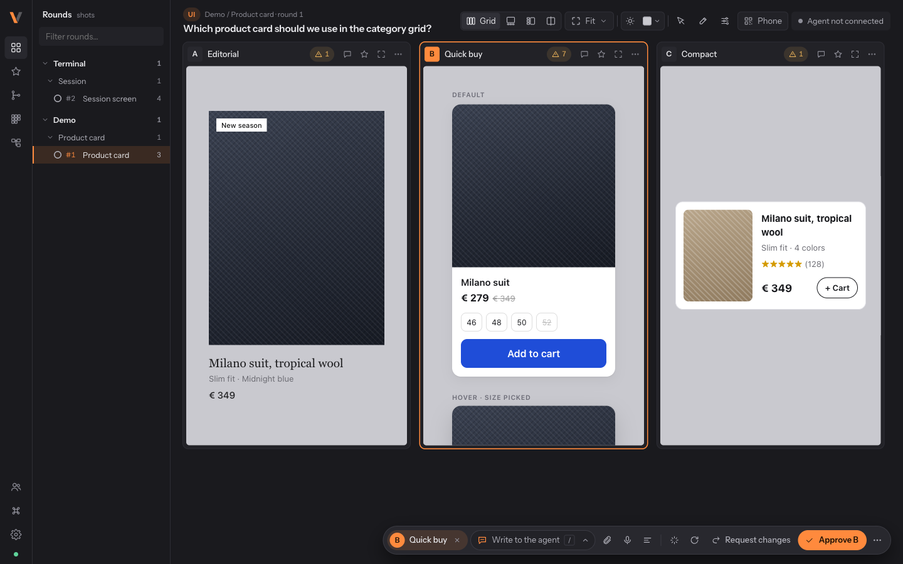
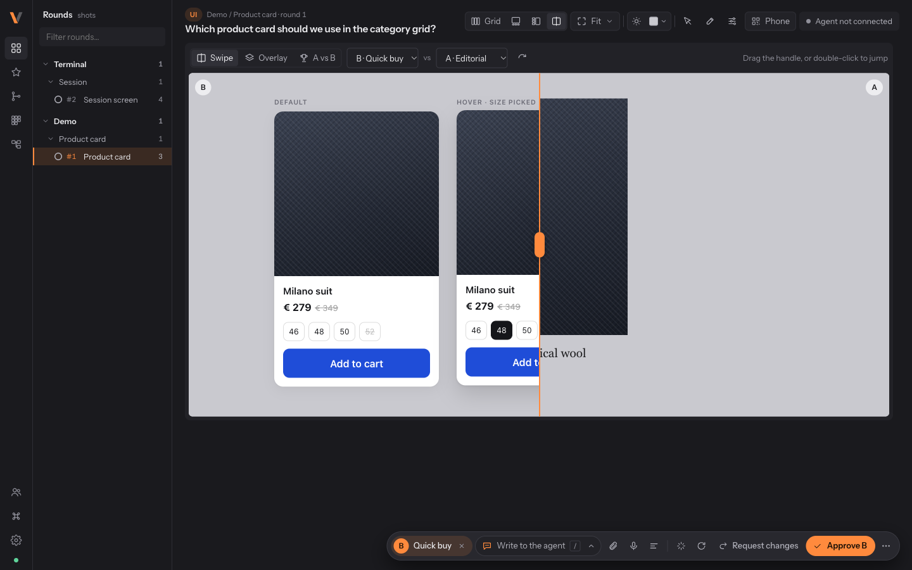
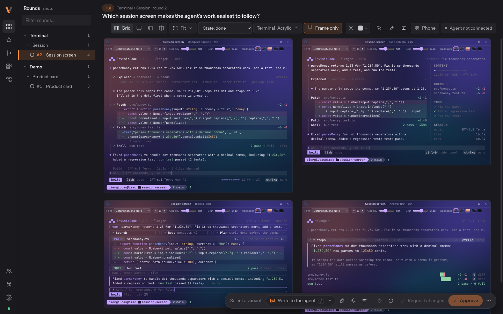
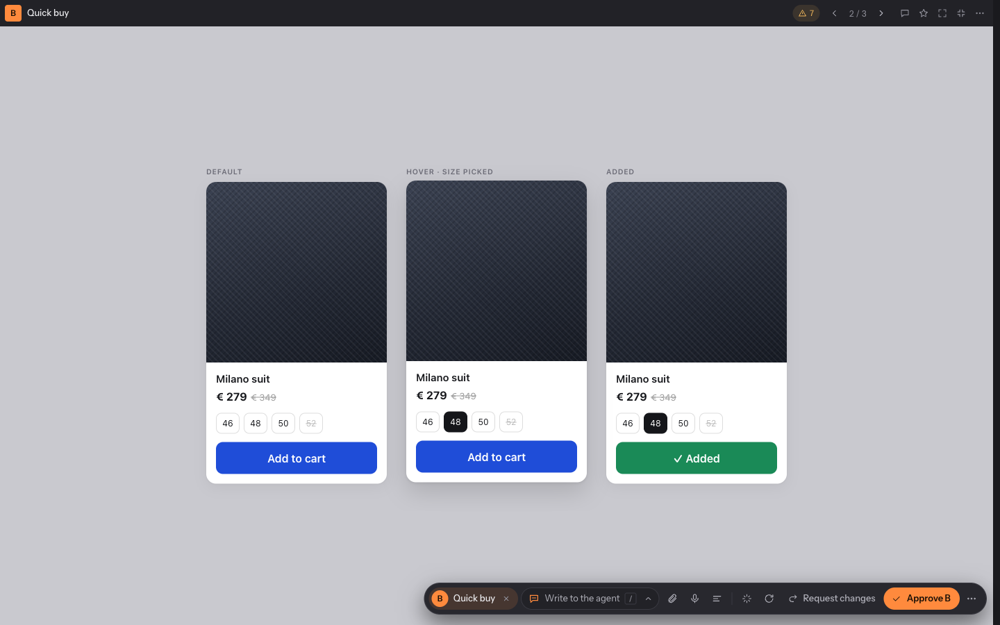
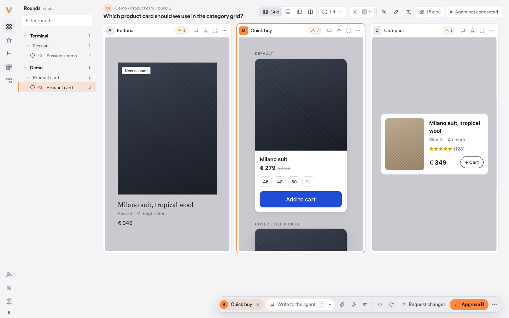
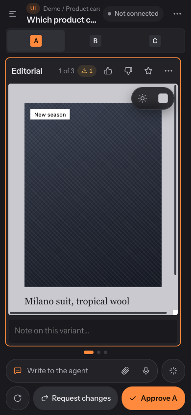

<p align="center">
  <picture>
    <source media="(prefers-color-scheme: dark)" srcset="assets/brand/wordmark-on-dark.svg">
    
  </picture>
</p>

<p align="center">Design variants you can see, compare and send back to your coding agent.</p>

Variant Studio is a skill for AI coding agents. Ask for a few versions of a button, a card, a form or a whole page: the agent writes them, they open side by side in your browser, and you choose. You can comment on a single element, rewrite a headline, drag a slider, attach a screenshot you like. The agent gets all of it as JSON and builds the next round, or implements the one you approved.

It works with Claude Code, Claude Desktop, Codex, Antigravity, Gemini CLI, Kilo Code, Cline, OpenCode, Cursor, GitHub Copilot, Grok Build, Z Code and any agent that can run Node.js. The skill is called `variant-studio` (`/variant-studio` in Claude Code).



<table>
  <tr>
    <td width="50%"><br><sub><b>Compare</b>: swipe, overlay, A vs B tournament, before/after</sub></td>
    <td width="50%"><br><sub><b>Design modes</b>: terminal, phone, desktop window and logo frames</sub></td>
  </tr>
  <tr>
    <td width="50%"><br><sub><b>Full screen</b> with arrow keys, exclusive or inside the page</sub></td>
    <td width="50%"><br><sub><b>Light theme</b>, and the interface in five languages</sub></td>
  </tr>
</table>

<p align="center"><br><sub><b>On your phone</b>: scan the QR code, swipe between variants, decide</sub></p>

## Install

**Linux / macOS**

```bash
curl -fsSL https://raw.githubusercontent.com/Fonlogen/variant-studio/main/install.sh | bash
```

**Windows** (PowerShell)

```powershell
irm https://raw.githubusercontent.com/Fonlogen/variant-studio/main/install.ps1 | iex
```

One command installs and updates. It asks:

1. **Which agents.** The ones found on your machine are already ticked; press `d` for detected only, `a` for all.
2. **Remote sharing.** Say yes to install [cloudflared](https://developers.cloudflare.com/cloudflare-one/connections/connect-networks/downloads/) (if it is missing) and let teammates outside your network open the studio. Say no and nothing extra is installed.
3. **Globally or into one project.**

Already installed? Run the same command: it replaces the old files, keeps your config files and shows the version change. Node.js 18 or newer is the only requirement. More options under [Installation](#installation).

To install an older release, add the version (see [Releases](https://github.com/Fonlogen/variant-studio/releases)):

```bash
curl -fsSL https://raw.githubusercontent.com/Fonlogen/variant-studio/main/install.sh | bash -s -- --version 2.0
```
```powershell
& ([scriptblock]::Create((irm https://raw.githubusercontent.com/Fonlogen/variant-studio/main/install.ps1))) -Version 2.0
```

## How it goes

1. You ask: *"Three versions of the pricing table"*, *"Alternatives for the checkout on mobile"*, *"Show me the empty state of the inbox two ways"*.
2. The agent creates a round, writes the variants and gives you a link.
3. You compare them, select one or more, and leave feedback.
4. You press **Approve**, **Request changes**, **Combine**, **More like this** or **Start over**.
5. The agent reads your decision and continues. It keeps listening while you look, and the studio shows whether it is.

Every round is kept, grouped by product area and subject, with iterations nested under the round they came from.

## What's new in 4.0

**One studio for every project**
- A single server on port 8065 (8066, 8067… if it is taken) serves all your projects. Each project is a session with its own 5-character PIN, stable across restarts: `http://variant-studio.localhost:8065/X91Z4`, or `?pin=X91Z4`. When port 80 is free and allowed (macOS, or with admin rights) the studio answers there too and the links drop the port: `http://variant-studio.localhost/X91Z4`.
- Opening the address without a PIN asks for one. On your own computer the same page lists the active sessions.
- `stop` closes only the current project; the server exits when no project is left. `stop --all` lists the other sessions and needs `--confirm`, so the agent asks you first, and the other sessions are told.

**On your phone**
- The *Phone* button shows a QR code for the whole gallery, and every card has one for its own variant. Pick local network or tunnel, owner (decides) or guest (looks and votes).
- A real phone layout: one variant at a time with A/B/C tabs and swipe, rating and star on the card, theme and background on the preview, the note under it, and *Write to the agent*, *More like this*, *Start over*, *Request changes* and *Approve* at the bottom. The rounds open as a bottom sheet, the note as a tall sheet.

**Design modes** (`--design`, per round, shown next to the title)
- `tui`: the variant is the screen of a terminal app. Acrylic, tabs, tmux, plain black, Ubuntu, CMD, PowerShell and Windows Terminal windows; Nerd Fonts or fonts on your computer; opacity, blur and wallpaper (`.variant-studio/wallpaper.*`, else the bundled one); a prompt you can type in, with your user and host name. The screen keeps its real 100 columns and scales down to fit the card.
- `app`: CSS phones. iPhone 8, X, 18; Pixel 3, 6, 8, 10 Pro; Galaxy S25 and S25 Ultra; realistic, flat or clay frames.
- `desktop`: window frames for macOS (current, Yosemite, Leopard, Aqua), Windows 11, 8/10, 7, XP, Ubuntu GNOME and KDE Plasma, at four window sizes, with or without the desktop around them.
- `logo`: the mark as a favicon in a browser tab, iOS and Android icons, sizes from 16 to 128, light, dark and monochrome.
- All styles sit in one grouped picker for the round; any variant can override them from its ⋯ menu.
- **Frame only** (on by default, toggle in the top bar): the card's border and background disappear and the phone, window or terminal sits straight on the gallery. A small button on the variant opens its options.
- The agent writes only what goes inside the frame: no drawn devices, windows or presentation boards, and `--viewports` is ignored because the frame sets the size.

**Logo and image tools** for the agent: `logo-export` (SVG, PNG 16–1024, favicon.ico, apple-touch-icon, maskable, manifest), `palette` (OKLCH scales with contrast ratios), `fonts` (curated pairs and local fonts) and `image` (OpenAI gpt-image, key in `OPENAI_API_KEY` or `~/.variant-studio/config.json`).

**Export** a variant as one self-contained HTML file, as `index.html` + `style.css` + `script.js`, or with the shared CSS in its own file.

**A lighter studio**
- Dark by default with an orange accent, lower bars, flat sidebar rows, a new logo.
- The prompt is a pill at the bottom right: it shows the usual actions, opens upward when you write, and can be hidden.
- The top bar shows the design mode and wraps instead of hiding the title.
- Full screen comes in two flavours, chosen from the full-screen view or the command palette: exclusive (the browser's full screen) or expanded to the whole page.

**Your layout, your background**
- Cards start the same size. Resize any of them freely by its edge or corner, in width and height (arrow keys work too; double-click resets).
- Pick the canvas behind the variants: light, gray (the default), dark, black, checkerboard or any color. Terminals, phones and windows use it too.
- Fixed-width components wider than their card are scaled down instead of cut off.

**Accessibility fixes in one click.** In the audit, *Ask the agent to fix them* sends the issues of one variant, or of all of them, and the agent edits the files in place.

**Fixes**
- The grid no longer jumps up and down at some window sizes (a scrollbar loop).
- No white edges behind phone and window frames when the variant theme differs from the studio theme.
- The installer no longer offers a second skill: it installs Variant Studio only.

## What's new in 3.5

- **Codex as a first-class agent**, next to Claude Code.
- **Mockup mode, on by default.** Variants are static designs: one HTML file each, no scripts, no working logic, no project scaffolding. GPT models in particular tended to build every variant as a working app, which costs a lot of tokens for a visual decision. `present` now refuses a round that breaks the rule and tells the agent what to remove. Switch to **prototype mode** when you do want clickable, working variants.
- **One subagent per variant (optional).** Instead of writing the variants one after another, the agent spawns a subagent for each and they work in parallel. The subagent model is chosen automatically, or pinned separately for each harness: `cc_subagent_model` (Haiku, Sonnet, Opus, Fable: always the newest of that family) and `cdx_subagent_model` (Luna, Terra, Sol, Astra: the newest GPT of that tier).
- Both live in **Settings → Generation** in the gallery, in the command palette, and in the `settings` command. Ask the agent in plain words ("switch to prototype mode", "use subagents with Sonnet") and it runs it for you.

| Command | Effect |
|---|---|
| `settings` | Show the current settings |
| `settings --mode mockup` / `--mode prototype` | Static mockups (default) / working prototypes |
| `settings --subagents on` / `off` | One subagent per variant / a single agent (default) |
| `settings --cc-subagent-model auto\|haiku\|sonnet\|opus\|fable` | Subagent model in Claude Code |
| `settings --cdx-subagent-model auto\|luna\|terra\|sol\|astra` | Subagent model in Codex |
| `… --global` | Save as your default for every project instead of this one |

## What's new in 3.1

- **Remote sharing.** A temporary public link through a Cloudflare tunnel, for teammates anywhere (Team panel, or `share`). Guests view, vote and comment; only you decide. The installer can set up cloudflared for you.
- **Variants map** (`M`). For each subject, the variant you chose in every round as a live thumbnail, with the branches that led from one round to the next.
- **Five languages.** English, Italian, Spanish, French and Russian. The studio starts from your browser's language, and the agent writes round titles, questions and labels in the same language.
- **Tall variants scroll inside their card**, so the grid stays one screen high. *Full height* in the viewport menu lets cards grow instead.
- **Tooltips on every control**, shown almost instantly and placed wherever there is room.
- **Installer and updater in one command.** Pick the agents (now also Claude Desktop and Cursor), and choose remote sharing. Running it again updates and keeps your config files.
- Fixes: variant names no longer cut to one letter on narrow cards; inspector tabs no longer slide under the close button.

## What's new in 3.0

**Fixes**
- Requests are queued. Pressing "Request changes" twice in a row no longer loses the first one, and decisions sent while the agent is busy wait for it.
- The agent no longer stops waiting after a few minutes. `present` hands the round over and keeps listening; the studio shows *Agent listening*, *Agent working* or *Agent not listening*.
- Sections and pages no longer show their mobile layout on a desktop round (or the reverse). The viewport is remembered per round, and the agent designs for the round's target width.

**Undo**
- An approval can be undone for 15 seconds: the agent receives it only after that. Other requests can be withdrawn until the agent picks them up.
- An approval can be revoked later. The agent is told, and asks before reverting code it already changed.

**Look**
- A new identity: the split‑V mark, a calm graphite theme with a light alternative, rounded and roomy so the previews get the space.
- Interface in English and Italian.

**Tuning**
- Controls declared by the agent for each round (radius, density, accent…) as sliders, pickers and selects.
- Font picker for headings and body text, applied to every variant.
- Brand palette: your colors and fonts injected into every variant.
- Switches for UI states (loading, empty, error) and content scenarios (long names, no image).
- Lock an element so the next round keeps it as is.
- Acceptance checklist with pass/fail per variant.

**Comparing**
- Grid with a toolbar on each card, and a full-screen view with a filmstrip and arrow keys.
- Overview of every round in a group, or the whole project, as live thumbnails.
- Swipe and overlay compare with a difference blend, and before/after against the previous round.
- A vs B tournament that ranks the variants for you.
- Device frames, synced scrolling, version tree.

**Feedback and sharing**
- Screenshots of what you saw go to the agent with the decision.
- Reference images: paste, drop or attach.
- Voice notes by dictation, saved prompts, quick chips.
- A notification and a sound when new variants are ready.
- Export a variant as PNG, JPG, standalone HTML with your changes applied, or the original HTML. Ask the agent for a React, Vue, Svelte or Tailwind version.
- Team review: teammates on your network open a link and vote, or you send them an offline gallery and import their votes.

## Features

| | |
|---|---|
| Scope | Components, sections and full pages, each with its own preview layout |
| Design modes | `ui`, `component`, `tui` (terminal window: acrylic, tabs or tmux; Nerd Fonts, opacity, blur, wallpaper, a prompt you can type in), `app` (CSS phones: iPhone 8 / X / 18, Pixel 3 / 6 / 8 / 10 Pro, Galaxy S25 / S25 Ultra; realistic, flat or clay frames), `desktop` (window frames: macOS, Yosemite, Leopard, Aqua, Windows 11 / 10 / 7 / XP, GNOME, KDE; sizes up to 1920×1080; optional desktop), `logo` (favicon, iOS and Android icons, sizes, monochrome). Styles for the whole round or per variant; *Frame only* shows just the device or window |
| Logo tools | `logo-export` (SVG, PNG 16…1024, favicon.ico, apple-touch-icon, maskable, manifest), `palette` (OKLCH scales with contrast ratios), `fonts` (curated pairs + local fonts), `image` (OpenAI gpt-image-1) |
| Export | Any variant as one self-contained HTML, HTML + CSS + JS, or HTML + shared CSS (zip from the gallery, folder from the CLI) |
| Views | Grid · Full screen · List · Compare (swipe, overlay, tournament, before/after) · Overview · Version tree · Variants map |
| Viewport | Fit, mobile, tablet, laptop, desktop or custom width, per round; device frames; zoom per card or for all; tall variants scroll inside their card (or switch to full height); free card resizing; exclusive or in-page full screen |
| Feedback | Selection, 👍/👎, notes per variant, comments on single elements, locked elements, inline copy edits, token overrides, checklist, reference images, screenshots |
| Tuning | Round controls, fonts, CSS tokens, brand palette, states and content scenarios, light/dark |
| Decisions | Approve · Request changes · Combine · More like this · Start over · Revoke · Ask for a component · Fix accessibility |
| Agent link | Queued decisions, undo window, presence indicator, `present` / `wait` that never give up on their own |
| Quality | JS errors and an accessibility audit (contrast, touch targets, alt text, labels, overflow) for you and the agent |
| Real stacks | Project CSS via `/p/…`, Tailwind, URL variants from Storybook or your dev server |
| Team | LAN or public (Cloudflare tunnel) review link with names and votes, or an offline voting gallery; guests can't decide |
| Offline | `build` writes a single HTML file; decisions are copied to the clipboard |
| Phone | QR codes for the gallery and for each variant, over the local network or a tunnel; a phone layout with one variant at a time, swipe and bottom sheets |
| Platforms | Dependency-free Node on macOS, Linux and Windows; one server for every project, a PIN per project |

## Installation

The installer copies (or links) the skill into the agents you choose, and updates it when it is already there. Use the one-liners above, or from a clone run `./install.sh`, `.\install.ps1`, or double-click `install.cmd`.

### Supported agents

| Id | Agent | Global folder | Project folder |
|---|---|---|---|
| `claude` | Claude Code | `~/.claude/skills/` | `.claude/skills/` |
| `desktop` | Claude Desktop | zip in `~/Downloads/` to upload | — |
| `codex` | Codex | `~/.agents/skills/` | `.agents/skills/` |
| `antigravity` | Google Antigravity | `~/.gemini/antigravity/skills/` | `.agent/skills/` |
| `gemini` | Gemini CLI | `~/.gemini/skills/` | `.gemini/skills/` |
| `kilo` | Kilo Code | `~/.kilo/skills/` | `.kilo/skills/` |
| `cline` | Cline | `~/.cline/skills/` | `.cline/skills/` |
| `opencode` | OpenCode | `~/.config/opencode/skills/` | `.opencode/skills/` |
| `cursor` | Cursor | `~/.cursor/skills/` | `.cursor/skills/` |
| `copilot` | GitHub Copilot | `~/.copilot/skills/` | `.github/skills/` |
| `grok` | Grok Build | `~/.grok/skills/` | `.grok/skills/` |
| `zcode` | Z Code | `~/.zcode/skills/` | `.zcode/skills/` |

On Windows `~` is your user folder (`C:\Users\<you>`).

**Claude Desktop** has no skills folder: the installer writes `variant-studio-skill.zip` to your Downloads. Upload it from *Settings → Capabilities → Skills → Upload skill*. Desktop chats run in a sandbox, so there the agent hands you a single-file gallery (`build`); in Desktop's *Code* tab the live studio works as in Claude Code, so install for `claude` too.

### Installer options

| Bash | PowerShell | |
|---|---|---|
| `--agents claude,codex` | `-Agents claude,codex` | Install for these agents, no menu |
| `--detected` | `-Detected` | Every agent found on this machine |
| `--all` | `-All` | Every supported agent |
| `--remote` / `--no-remote` | `-Remote` / `-NoRemote` | Turn remote sharing on (installs cloudflared if needed) or off, without asking |
| `--project [DIR]` | `-Project DIR` | Install into a project (committable) instead of your user profile |
| `--link` | `-Link` | Symlink / junction to your clone, so `git pull` updates every agent |
| `--uninstall` | `-Uninstall` | Remove the skill from the chosen agents |
| `--list` | `-List` | Show agents, paths and what was found |
| `--yes` | `-Yes` | Don't ask for confirmation |
| `--version 2.0` | `-Version 2.0` | Install that release instead of the latest |

With the one-liners:

```bash
curl -fsSL https://raw.githubusercontent.com/Fonlogen/variant-studio/main/install.sh | bash -s -- --agents claude,codex --yes
```
```powershell
& ([scriptblock]::Create((irm https://raw.githubusercontent.com/Fonlogen/variant-studio/main/install.ps1))) -Agents claude,codex -Yes
```

The installer never overwrites a folder that isn't Variant Studio. Running it again updates an existing install: everything is replaced except `config.json`, `config.local.json` and `*.local.json` in the skill folder. Your own settings live in `~/.variant-studio/config.json` (remote sharing on/off, path to cloudflared) and are never touched by updates. cloudflared comes from Homebrew or winget when available, otherwise from [Cloudflare's releases](https://github.com/cloudflare/cloudflared/releases) into `~/.variant-studio/bin/`. For agents without skill support, paste `agents-snippet.md` into their instructions file (`AGENTS.md`, `GEMINI.md`, a Cursor rule…) and fix the path.

To try it from any project folder:

```bash
node ~/.claude/skills/variant-studio/scripts/studio.mjs start --project . --open
node ~/.claude/skills/variant-studio/scripts/studio.mjs demo --project .
```

## In the studio

Click a card's letter or press `1`–`9` to select it. Press `C` and click an element to comment on it or lock it, `E` to rewrite text, `I` to open the inspector. Write a note in the bar at the bottom and send with the buttons or `Ctrl/⌘ Enter`. Everything else is in the command palette (`Ctrl/⌘ K`).

| Key | Action |
|---|---|
| `G` `F` `L` `X` | Grid · Full screen · List · Compare |
| `O` · `T` · `M` | Overview · Version tree · Variants map |
| `←` `→` | Previous / next variant; pick a side in the tournament |
| `Z` / `Esc` | Full screen on the active variant / back |
| `+` `−` `0` | Zoom in, out, fit |
| `1`–`9` | Select a variant |
| `C` · `E` · `I` | Comment or lock · Edit text · Inspector |
| `N` · `D` · `U` | All descriptions · Variant light/dark · Studio theme |
| `/` · `R` | Write a note · Rounds panel |
| `Ctrl/⌘ K` | Command palette |
| `Ctrl/⌘ Enter` | Send |

## Team review

- **Same network:** the studio already listens on your network, always behind the PIN. The Team panel and the *Phone* QR give a guest link; teammates open it, enter their name, vote and comment. Their votes go to the agent with your decision, and your choice still wins.
- **Outside your network:** open the Team panel and press *Share outside your network*, or ask the agent to run `share`. You get a temporary `https://….trycloudflare.com` link (no Cloudflare account needed). *Stop sharing* closes it and every link handed out stops working. Needs remote sharing turned on in the installer.
- **Offline:** ask for `build --team` and send the HTML file. Teammates vote offline and download a votes file, which you import from the Team panel.

Teammates are guests: they can look, vote, comment and export images, but they cannot approve or request changes, upload files, change settings or read your project's source files.

## Files in your project

Everything lives in `.variant-studio/`, added to `.gitignore` automatically. Sessions, PINs and your settings live in `~/.variant-studio/`.

```
.variant-studio/
  global.css              optional design-system tokens for every round
  brand.json              your brand palette and fonts (Settings)
  settings.json           mockup/prototype mode, subagents and their models (Settings → Generation)
  wallpaper.png           optional wallpaper behind TUI terminals
  rounds/001-product-card/
    round.json            group, question, kind, viewports, controls, labels and notes
    a.html b.html c.html
    _refs/  _shots/       reference images and screenshots sent with decisions
    decision.json         the latest decision for this round
  exports/                components the agent wrote for you
  state/                  server info, decision queue, votes, logs
```

## Skill layout

```
variant-studio/
  SKILL.md                   instructions for the agent
  agents-snippet.md          the same, short, for AGENTS.md / GEMINI.md
  install.sh  install.ps1  install.cmd
  scripts/studio.mjs         CLI entry point, no dependencies
  scripts/lib/               server, sessions and PINs, rounds, decisions, export, logo tools, tunnel, QR
  scripts/ui/                the studio: app.html, app.css, js/, frame.js (runs inside previews), base.css
  scripts/ui/shell/          terminal, phone, desktop and logo wrappers for the design modes
  scripts/ui/vendor/         QR encoder (MIT)
  references/                round.json schema, platforms, frameworks
  assets/brand/              logo, mark and app icon (SVG)
  assets/wallpapers/         default TUI wallpaper
  assets/screenshots/        images for this README (not installed)
  assets/demo-round/         sample round
```

Inspired by the Visual Companion in [superpowers](https://github.com/obra/superpowers), written from scratch.
